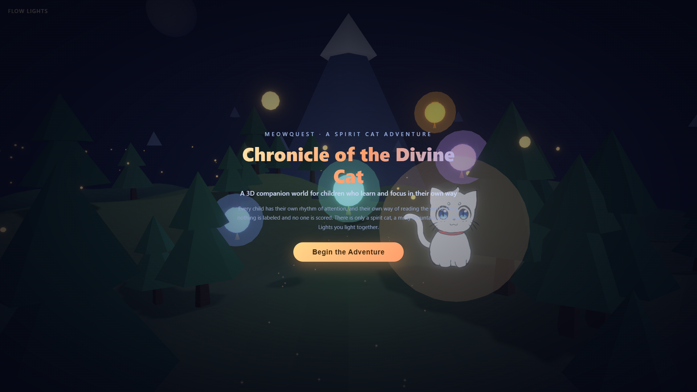
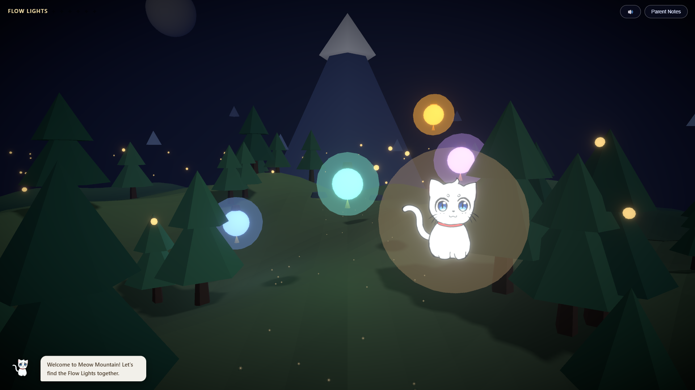
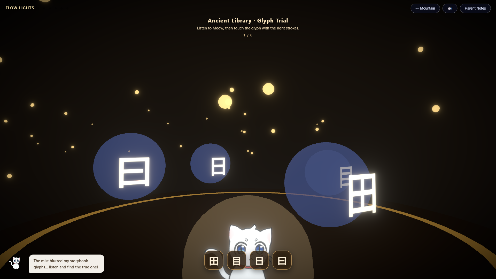
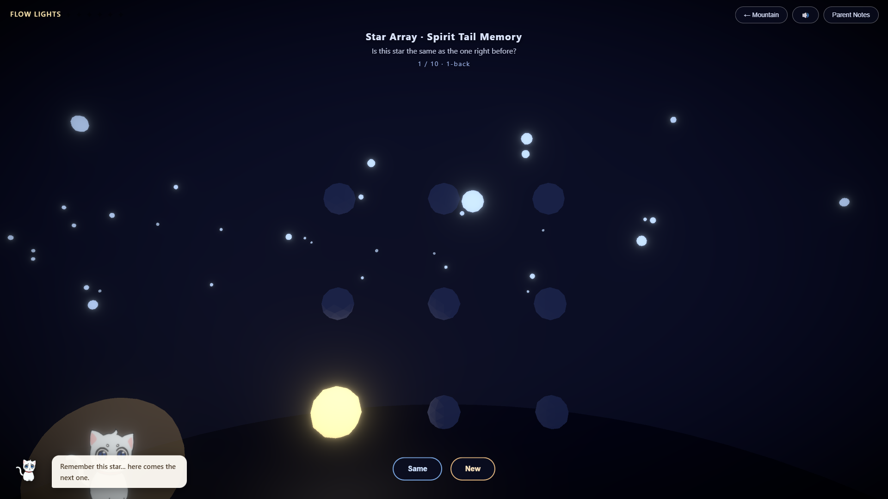
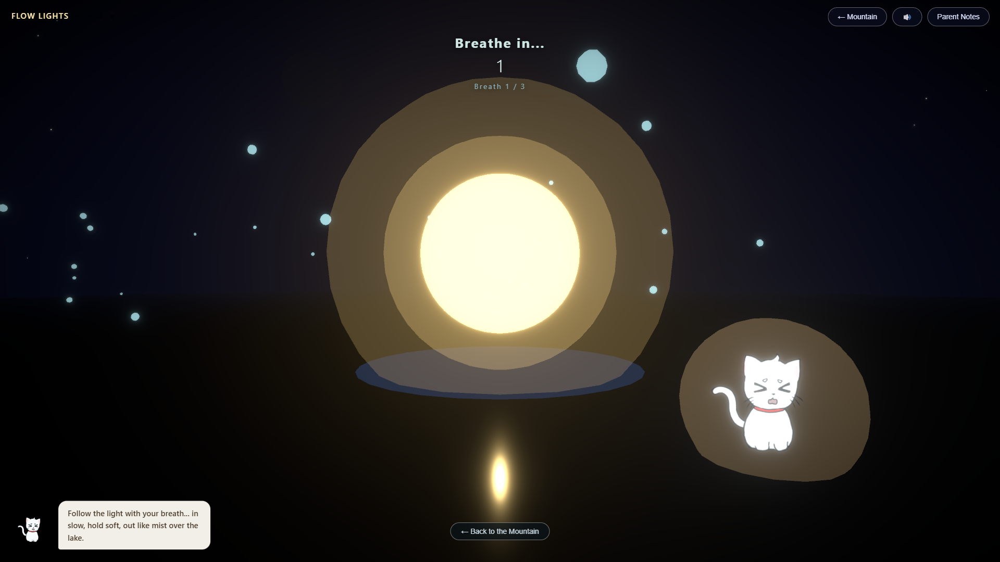
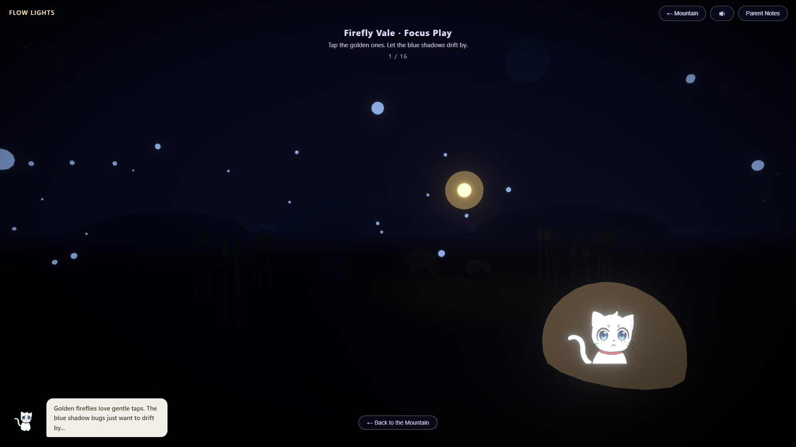
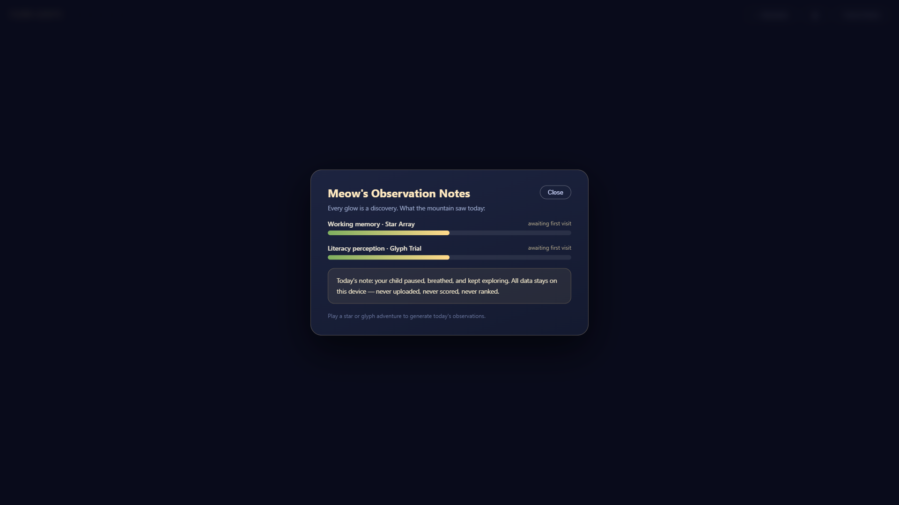

<a id="top"></a>

<div align="center">
  <h1>🐱 MeowQuest 3D Demo</h1>
  <h3>灵猫记 · 3D 陪伴游戏原型</h3>
  <p><strong>不是诊断，而是一次发现。<br>不是训练，而是一起长大。<br>每一个孩子，都被温柔地看见。</strong></p>
  <p><em>Not a diagnosis, but a discovery · Not training, but growing together · Every child, gently seen</em></p>
  <p>
    <a href="#demo-scope"></a>
    <a href="#training-modules"></a>
    <a href="#ai-layer"></a>
    <a href="#tech-stack"></a>
  </p>
  <p>
    <a href="LICENSE"></a>
    <a href="#quick-start"></a>
    <a href="#roadmap"></a>
  </p>
</div>

---

## 📖 这是什么 What This Is

**MeowQuest 3D Demo** 是一个面向 **6–12 岁** 儿童的**游戏化早期风险筛查原型**。孩子在神猫山自由探索，点亮灯笼进入五项认知训练模块，在陪伴式 AI 伙伴的引导下完成读写知觉、工作记忆、抑制控制、持续注意与情绪调节的任务。

> **一个游戏，两个屏 —— 读写与注意力，用「做」来评估，而不是用「打分」来评估。**

**这是一个 Demo，不是完整产品。** 本 README 严格区分**已实现的代码**与**尚未开发的部分**：Demo 涵盖 3D 场景、五个训练模块、AI 能力层、家长端与数据自持能力；完整产品所需的十二章剧情、临床验证与后端服务仍在路线图上（见[下一步开发计划](#roadmap)）。

| | |
|---|---|
| 🎮 **形态** | Web 3D 陪伴游戏（React + Three.js），浏览器直接运行 |
| 👶 **目标用户** | 6–12 岁儿童及家长/监护人 |
| 🧠 **训练维度** | 工作记忆 · 读写知觉 · 抑制控制 · 持续注意 · 情绪调节 |
| 🐱 **陪伴角色** | 灵猫 Momo（3D 模型）、猫头鹰工匠、萤火向导、齿轮兽 Cog（AI） |
| 🤖 **AI 能力** | 对话陪伴 · 家长观察笔记 · 云端 TTS 语音（三级降级） |
| 🚫 **产品边界** | **非诊断工具**，不做任何临床结论；数据默认不出浏览器 |
| 📊 **代码规模** | 约 13,500 行 TypeScript / TSX，80 个源码文件 |

---

<a id="demo-scope"></a>

## 🎮 Demo 包含什么 Demo Scope

### 8 个可玩场景

| 场景 | 中文名 | 类型 | 玩家做什么 |
|---|---|---|---|
| **Meow Mountain** | 神猫山 · 启程林 | 自由探索 Hub | 3D 环视、驾驶灵猫走动、点灯笼进小游戏、穿灵门进主线 |
| **The Cloud Bridge** | 云关 · 第一章 | 剧情过场 | 木制营地与云海的叙事布景 |
| **Cloud Bridge** | 云桥驿站 | 主线玩法 | 推车运石铺桥，9 相位状态机 + 载重决策 + 风力机制 |
| **Star Array** | 星阵记忆 | 训练模块 | 空间 N-back + 序列回忆，双阶段 |
| **Ancient Library** | 古书阁 · 符形试炼 | 训练模块 | 听音辨形，在悬浮字形徽章中选目标 |
| **Whispering Lake** | 低语湖畔 · 呼吸正念 | 训练模块 | 跟随光球做 4-4-6 呼吸节拍 |
| **Firefly Vale** | 萤火虫谷 | 训练模块 | GO/NO-GO 抑制控制，点金不点蓝 |
| **Stepping Stones** | 溪光石阶 | 训练模块 | 尽快点中发光的石阶 |

<details>
<summary>📷 真实运行截图（1920×1080 真机采集）</summary>









</details>

### 云桥驿站：Demo 里最完整的玩法

玩家推车把石料从云端采石场运到云桥缺口，铺满桥面即通关。**这里刻意埋了一组与执行功能相关的设计**：

| 机制 | 具体实现 |
|---|---|
| **载重决策** | 4 档载重（1–4 块），速度 ×1.0 / 0.88 / 0.72 / 0.55，能耗 0.5 / 1.5 / 3 / 5 |
| **思考保护** | 装车有 **1.5 秒保护期**不烧香 —— 惩罚的不是思考，而是抢先动手 |
| **计划权衡** | 载重 3 的计划权重最高（1.0），但结算时权重越高**扣分越多** —— 重载急拉反而降低精度 |
| **风力干扰** | 确定性伪随机触发，`warning` 0.8s → `gusting` 1.5s（重载 3s），强风期间**车辆完全停止** |
| **避免连续遇风** | 上一趟遇风则本趟不再遇风，避免连续挫败 |
| **能量管理** | 能量 10 点，能量不足自动进休息相位，休息回满 |
| **无倒计时催促** | 香是「温和的资源提醒」而非计时器；不烧香只是少拿奖励 |

<a id="training-modules"></a>

### 五个训练模块

| 模块 | 认知维度 | 玩法 | 试次 | 自适应 |
|---|---|---|---|---|
| **Star Array** 星阵记忆 | 工作记忆 | 阶段 A 空间 N-back（Same/New 判断）+ 阶段 B 顺序回忆 | 10 + 3×(3–6) | ✅ N-back 1↔2 档、序列长度 3–6 档 |
| **Glyph Trial** 符形试炼 | 读写知觉 | 听 momo 读词，在形近字徽章中点出目标 | 8 回合 | ✅ 选项数 3–5 |
| **Calm Breathing** 呼吸正念 | 情绪调节 | 跟随光球做 4-4-6 呼吸（4s 吸 / 4s 屏 / 6s 呼） | 3–4 轮 | ❌ 无难度档（每日轮数 3/4） |
| **Firefly Vale** 萤火虫谷 | 抑制控制 | 金色萤火虫要点，蓝色影子不能点 | 16 试次（GO:NO-GO = 12:4） | ⚠️ 仅局内窗口后半程缩短 25% |
| **Stepping Stones** 溪光石阶 | 加工速度 + 持续注意 | 尽快点中发光的石阶（7 块） | 20 试次 | ✅ 节奏倍率 0.6–1.6 |

**难度自适应引擎**（`src/lib/adaptive.ts`）以 **60%–85% 正确率**为目标心流带：高于 85% 升档、低于 50% 降档。

---

## 🐱 陪伴系统 Companion System

### 灵猫 Momo 的 8 种情绪

代码定义了 8 种情绪与 8 张差分表情图（`public/cat/1–8.png`）：

| 情绪 | 图 | 情绪 | 图 |
|---|---|---|---|
| `happy` 开心 | `cat/1.png` | `proud` 自豪 | `cat/5.png` |
| `excited` 兴奋 | `cat/2.png` | `calm` 平静 | `cat/6.png` |
| `curious` 好奇 | `cat/3.png` | `surprised` 惊讶 | `cat/7.png` |
| `encouraging` 鼓励 | `cat/4.png` | `sleepy` 困倦 | `cat/8.png` |

> **注意**：`sleepy` 已定义但代码中暂无触发路径。表情图仅用于五个小游戏场景与 2D 头像，神猫山与云关使用的是 3D GLB 模型。

### Momo 的两套渲染路径

| 场景 | 实现 | 说明 |
|---|---|---|
| 神猫山 / 云关 | **3D GLB 模型**（`public/momo/`，5 个变体） | 静止 / 表情 A / 表情 B / 行走帧 A / 行走帧 B，共约 223 MiB |
| 五个小游戏 | **Billboard 贴图** | 8 张差分表情图，alphaTest 裁切 + 加色柔光球 |

`ProceduralMomo` 负责 GLB 的运行时归一化（统一到 2.2 单位高）与程序化动画（呼吸浮动、行走抬腿、竖向拉伸），变体切换用 `damp` 做「软着地」过渡。

### 成长系统

按累计心流之光分三阶段：**0–4 盏**无光环 → **5–9 盏**暖金光环 → **10 盏以上**青金双色光环 + 3 颗绕头公转的金星。

### 对话与成就

- **台词库** `src/data/companions.ts`：5 个游戏 × intro / result / 反思三档，共 100+ 条；`catLines.ts` 另有 10 条点击回应 + 6 条闲逛碎碎念
- **篝火谈心卡**：每个游戏结算后问一个开放式问题（emoji 选项 + 伙伴回应朗读）
- **8 个成就**（`src/store/achievements.ts`）：First Light · Glyph Friend · Star Keeper · Perfect Glow · Calm Lake · Firefly Friend · Swift Stream · Mountain Glow —— **只庆祝「做到了什么」，永不展示分数、排名或失败**

---

<a id="ai-layer"></a>

## 🤖 AI 能力层 AI Layer

### 对话陪伴与家长笔记

| 能力 | 模型 | 端点 | 超时 |
|---|---|---|---|
| Cog 对话补全 | `ecnu-plus` | `/ai-api/v1/chat/completions` | 10s |
| 语音合成 | `ecnu-tts` | `/ai-api/v1/audio/speech` | 8s |

AI 服务来自 **华东师范大学开放平台**（`chat.ecnu.edu.cn`，OpenAI 兼容协议），经 Vite 代理 `/ai-api` 转发以规避 CORS。

**Cog（齿轮兽 AI 助手）的硬红线**（`src/lib/assistant.ts`）：

- 禁说分数、数字、排名
- 禁词表：`test` `score` `fail` `lesson` `training` `treatment` `ADHD` `dyslexia` `disorder` `diagnosis` `deficit` `symptom` `therapy`
- 禁给医疗建议
- 孩子表达痛苦时**必须引导其找家长或老师**

**AI 家长观察笔记**输出恰好三段：`Seen today` / `Shining strengths` / `Gentle next steps`，总长 ≤120 词，禁用一切临床词汇。

### 三级语音降级链

| 级别 | 方案 | 说明 |
|---|---|---|
| 一级 | `ecnu-tts` 云端 TTS | 15s 安全阀；被浏览器手势策略拦截时自动降级 |
| 二级 | 浏览器 `speechSynthesis` | 按角色匹配音色（`female_sweet` / `male_steady` / `labixiaoxin`） |
| 三级 | 纯字幕 | 对话条照常显示 |

对话降级另有 **15 条静态话术**（5 类 × 3 条），按问题长度确定性选取（同问必同答，便于回归测试），**不使用随机数**。AI 调用失败永不阻塞游戏流程。

### AI 同意机制

`src/store/aiConsent.ts` + `src/ui/AIConsentDialog.tsx` 提供家长同意弹窗，明确披露会发送哪些数据（游戏类型、正确率、反应时、试次数、心流之光、篇章进度、当前难度），并警告：

> ⚠️ 本 Demo 的 API Key 配置在浏览器端，**不得**在公开部署中作为密钥使用，生产环境应改用服务端代理。

---

## 📊 家长端与数据自持 Parent View & Data Control

### 家长端「观察笔记」

家长端**只呈现特点与潜力，永不呈现缺陷、分数与排名**。两条能量条（工作记忆 / 读写）用去标签化的描述呈现。

### 风险信号评估（`src/lib/riskSignals.ts`）

**纯函数、纯本地、零副作用** —— 不读时钟、不用随机数、不读写 localStorage、不发网络请求，同输入必同输出。

七个维度各计至多一分，聚合为三档温和状态：

| 状态 | 触发 | 建议动作 |
|---|---|---|
| `calm` 平稳 | 0–1 分 | 无 |
| `watch` 多留意 | 2–3 分 | `rest` |
| `support` 多一点陪伴 | ≥4 分 | `breathe` |

三条保护性规则：

- **看到进步就撤回干预** —— 最近窗口明显回升（+0.15）则下调一档
- **历史不足 4 局不允许给 support** —— 避免误判与打扰
- **主动做过呼吸练习则减一分** —— 避免把「刚学会休息」读成状态下滑

### 数据自持

| 能力 | 实现 |
|---|---|
| **一键导出** | `exportLocalData()` 导出全部 7 个本地存储键为 JSON |
| **一键清除** | `clearLocalData()` 清空并刷新页面 |
| **本地持久化** | 心流之光、战绩、篇章进度、成就、对话记录、云桥进度全部存 localStorage |

> 全部数据默认**只留在浏览器**，不上传任何服务器。

---

<a id="tech-stack"></a>

## 🏗️ 技术栈与架构 Tech Stack & Architecture

### 技术栈

| 层 | 选型 | 版本 |
|---|---|---|
| UI 框架 | React | 18.3.1 |
| 3D 引擎 | three | 0.169.0 |
| 3D 集成 | @react-three/fiber / drei | 8.17.10 / 9.114.0 |
| 后处理 | @react-three/postprocessing | 2.16.3 |
| 状态管理 | zustand | 5.0.13 |
| 构建 | Vite + TypeScript | 5.4.11 / 5.6.3 |
| 资产采集 | puppeteer-core | 25.16.0 |

### 架构分层

```
src/
├── scenes/      # 3D 场景：神猫山 / 云关过场 / 云桥驿站 + convoy 子目录
├── games/       # 五个训练模块，每个含 Scene.tsx（3D）与 Overlay.tsx（2D）
├── objects/     # 可复用 3D 物件：地形 / 树 / 灯笼 / 灵门 / 心流之光 / 萤火虫 / Momo
├── lib/         # 纯逻辑：自适应引擎 / 风险信号 / 云桥规则 / AI 客户端 / 语音 / 音效 / 每日挑战
├── store/       # zustand 状态：游戏流程 / 成就 / 问对 / AI 同意 / 对话 / 云桥
├── ui/          # 2D 界面：HUD / 首页 / 家长端 / 对话条 / 成就提示 / 验证面板
├── data/        # 静态内容：猫台词 / 伙伴台词 / 符形题库（20 题）
└── effects/     # 后处理：Bloom + Vignette
```

### 3D 与 2D 严格分离

3D 场景层在 `<Canvas>` 内，2D UI 层在 `<Canvas>` 外 —— `div` / `img` 等 DOM 元素**绝不**放进 Canvas 子树。两者通过 `window.__mqScenes` 注册的场景控制接口通信（不走 zustand，因 R3F 使用独立 reconciler）。

### 值得一说的工程细节

| 细节 | 说明 |
|---|---|
| **Canvas 常驻不卸载** | R3F 的 Canvas 卸载时会删除全局 roots 表项，导致场景切换后画面冻结、帧循环停摆。改为只切换内部场景组件 |
| **FramePump 在 Suspense 之外** | 场景 suspend 时 React 会销毁边界内的 layout effect，`useFrame` 订阅随之被移除 |
| **禁用 3D 文本** | troika / drei `<Text>` 的 Worker 加载 woff2 会挂起 Suspense。符形试炼改用 Canvas 手绘纹理 + Billboard |
| **帧循环用 dt 累积** | 全部小游戏以 `useFrame` 的 `dt` 推进时间线，不用 `setTimeout` / `setInterval` |
| **帧率无关平滑** | 全项目使用 `THREE.MathUtils.damp`，角度插值用 `dampAngle` 归一化避免 360° 跳变 |
| **程序化地形** | 三层正弦噪声生成 65×65 顶点网格，中央小径自动压平；顶点色从山谷深绿渐变到山脚暖金 |
| **实例化渲染** | 远山（9）、云层（13/10）、萤火虫（26–90）、桥面石与栏杆均用 `InstancedMesh` + 逐实例染色 |
| **程序化布料与绳索** | 旗帜逐帧位移 + 重算法线；绳索沿 `CatmullRomCurve3` 采样生成 `TubeGeometry` |
| **昼夜系统** | 真实时钟换算（06:30–17:30 为白天），`damp` 平滑过渡背景色、雾、环境光与方向光 |
| **reduced-motion** | `prefers-reduced-motion` 同时在 CSS 层与 3D 层生效，关闭位移、布料、云漂与相机跟随 |
| **无障碍** | `role="meter"` + `aria-valuenow`、`aria-live` 播报、`sr-only` 文本、完整键盘操作（数字键选石垛、Enter 推车、Esc 返回）、离开二次确认 |

---

<a id="quick-start"></a>

## 🚀 快速开始 Quick Start

### 环境要求

- Node.js 18+（开发使用 Node 20）
- 现代浏览器（Chrome / Edge，需 WebGL2）

### 安装与运行

```bash
git clone https://github.com/Ceizon/meowquest-3d-demo.git
cd meowquest-3d-demo
npm install
npm run dev
```

开发服务器端口见 `vite.config.ts`（`5188`），AI 代理 `/ai-api` 同步生效。

### 构建与预览

```bash
npm run build     # 产物输出到 dist/
npm run preview   # 预览生产构建（端口 4173）
```

### 启用 AI 能力（可选）

Demo 的 AI 功能默认**关闭**，无 Key 时自动降级为浏览器 TTS 与静态话术，游戏完全可玩。

```bash
# 创建 .env.local 并填入 ECNU 开放平台 Key
echo "VITE_ECNU_KEY=sk-你的密钥" > .env.local
```

也可在家长端页面直接填入 Key，存入 `localStorage["mq-ai-key"]`，**无需重启**。

> ⚠️ `.env.local` 已被 `.gitignore` 忽略，**请勿提交密钥**。生产部署必须改用服务端代理。

### 开发者脚本

```bash
node scripts/capture-assets.mjs               # 真机采集 1920×1080 关键帧 + FPS 实测
node scripts/capture-assets.mjs --park=roam   # 停驻在指定画面，供手动录屏
node scripts/verify-convoy.mjs                # 云桥规则的无头回归测试
```

### 调试入口

浏览器控制台提供快捷 API：

```js
mq.go("mountain")      // 跳转任意屏幕
mq.lights()            // 当前心流之光数量
mq.results()           // 全部战绩
mq.quest()             // 当日三章进度
```

---

<a id="roadmap"></a>

## 🗺️ 下一步开发计划 Roadmap

以下为 Demo **尚未实现**的部分，按优先级排列。Demo 已验证的技术底座（3D 场景、五个训练模块、AI 层、家长端、数据自持）可直接复用。

### P0 · 补齐产品闭环

| 项 | 现状 | 目标 |
|---|---|---|
| **十二章剧情** | Demo 仅实现云关第一章（云桥驿站） | 完成 12 个地标章节：都江堰、墨家机关城、楼兰古国等 |
| **符形试炼指标修正** | 错误数被统计但未进入任何指标，`accuracy` 实际恒为 1.0 | 将错误次数纳入正确率计算，修正自适应依据 |
| **成就覆盖云桥** | `TASK_NAMES` 与成就判定均不含 `convoyBridge` | 补充云桥相关成就与展示名映射 |
| **自适应档位持久化** | 四个难度档位不写 localStorage，刷新即回默认值 | 跨会话保留孩子的难度曲线 |

### P1 · 临床与研究基础

| 项 | 现状 | 目标 |
|---|---|---|
| **真实用户证据** | **尚未收集**，原型不主张任何长期有效性 | 社区家庭试用 + 随访调研 |
| **随机对照试验** | 未开展 | 按预注册方案开展 RCT |
| **指标扩充** | 家长端仅两条能量条（工作记忆 / 读写） | 覆盖抑制控制、持续注意、情绪调节三个维度 |
| **数据上报规范** | 数据仅存 localStorage | 建立合规的行为数据采集与匿名化方案 |
| **十二周 CBT 课程** | 未实现 | 将 12 周渐进课程映射到剧情章节（正念 + 认知训练 + 读写） |

### P2 · 平台化与工程化

| 项 | 现状 | 目标 |
|---|---|---|
| **AI 服务端代理** | Key 在浏览器端（仅限 Demo） | 迁移到服务端代理，前端只持有会话令牌 |
| **同意流程前置** | `requestConsent()` 仅在家长端页面被调用，Cog 聊天不主动请求同意 | 首次使用 AI 前统一征得同意 |
| **模型格式转换** | GLB 资产共 223 MiB | 引入 glTF 压缩（Draco / Meshopt）与 LOD |
| **首屏体积** | 构建产物单 chunk 1.40 MB（gzip 392 KB），Vite 已提示超限 | 按场景动态 import 拆分 chunk，首屏只加载必要场景 |
| **移动端适配** | 以桌面浏览器为主 | 触控优化、竖屏布局、性能分级 |
| **可访问性深化** | 已支持键盘与 reduced-motion | 屏幕阅读器全流程走查、色盲友好配色 |
| **自动化测试** | 仅云桥规则有无头测试 | 补齐各模块逻辑与关键路径的单元测试 |

### P3 · 内容与生态

| 项 | 现状 | 目标 |
|---|---|---|
| **题库扩充** | 符形题库 20 题 | 扩充至数百题，按形近类别分层 |
| **语音角色** | 4 个角色音色 | 增加更多音色与方言支持 |
| **家长教育内容** | 仅两条陪伴建议 | 编写完整的家长引导手册 |
| **多语言** | 中文为主 | 英文界面与配音 |

---

<a id="disclaimer"></a>

## ⚠️ 重要声明 Important Disclaimer

1. **非诊断声明**：本项目是**早期风险筛查原型**，仅输出温和的状态提示，**不构成也不替代**任何医学诊断、治疗方案或临床建议。
2. **无临床效力**：真实用户证据**尚未收集**，随机对照试验**待开展**。本原型**不主张**已验证的长期有效性。
3. **AI 边界**：AI 输出的家长笔记由大模型生成并经提示词约束，**未经临床审校**，仅供陪伴参考。
4. **密钥安全**：Demo 的 AI Key 配置在浏览器端，**不得**作为密钥用于公开部署。
5. **未成年人保护**：产品面向 6–12 岁未成年人设计。实际使用须在监护人知情同意下进行，并遵守当地未成年人个人信息保护规定。
6. **数据本地**：所有行为数据默认仅存于浏览器本地，导出由用户主动触发。

---

## 📂 目录结构 Repository Structure

```
meowquest-3d-demo/
├── index.html                  # 入口，含 Noto Sans SC 字体与内联 SVG favicon
├── vite.config.ts              # 构建配置 + /ai-api 代理
├── tsconfig.json
├── package.json
├── .env.local                  # ECNU Key（已 gitignore，勿提交）
├── docs/
│   └── screenshots/            # 真实运行截图
├── public/
│   ├── momo/                   # Momo GLB 模型 5 个变体（约 223 MiB）
│   ├── cat/                    # 灵猫表情差分图 8 张
│   └── fonts/                  # Noto Sans SC woff2
├── scripts/
│   ├── capture-assets.mjs      # 真机截图 + FPS 实测采集
│   └── verify-convoy.mjs       # 云桥规则无头回归测试
└── src/
    ├── App.tsx                 # 场景路由 + Canvas 常驻策略 + CameraRig
    ├── main.tsx
    ├── scenes/                 # 3D 场景（14 文件 / 2,977 行）
    ├── games/                  # 五个训练模块（10 文件 / 2,750 行）
    ├── lib/                    # 纯逻辑层（11 文件 / 1,664 行）
    ├── store/                  # zustand 状态（8 文件 / 1,827 行）
    ├── ui/                     # 2D 界面（12 文件 / 2,683 行）
    ├── objects/                # 3D 物件（9 文件 / 993 行）
    ├── data/                   # 台词与题库（3 文件 / 389 行）
    └── effects/                # 后处理
```

---

<a id="team"></a>

## 👥 团队 Team

**adhd 无言以队**

陈勤中 · 刘真验 · 杨晨露 · 翁廷楷 · 江鹏

> *Thanks for being with us on this journey. It's been a joy to meet all of you.*

---

## 📄 许可 License

本项目采用 **MIT 许可证** —— 详见 [LICENSE](LICENSE)。

```bibtex
@misc{meowquest3ddemo2026,
  title        = {MeowQuest 3D Demo: A Spirit Cat Adventure},
  author       = {Chen Qinzhong and Liu Zhenyan and Yang Chenlu and Weng Tingkai and Jiang Peng},
  year         = {2026},
  howpublished = {\url{https://github.com/Ceizon/meowquest-3d-demo}},
  note         = {React Three Fiber prototype for a game-based early screening tool for children aged 6--12}
}
```

---

<div align="center">
  <p><strong>🐱 MeowQuest 3D Demo</strong></p>
  <p><em>Not a diagnosis, but a discovery. Not training, but growing together.</em></p>
  <p><a href="#top"></a></p>
</div>
